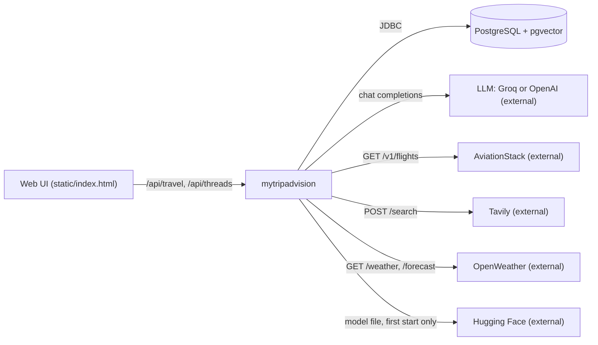
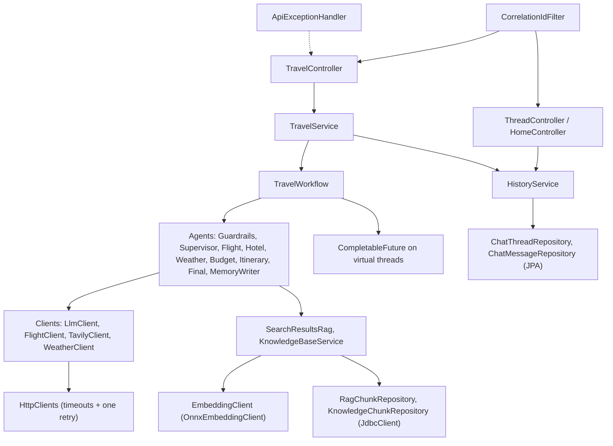
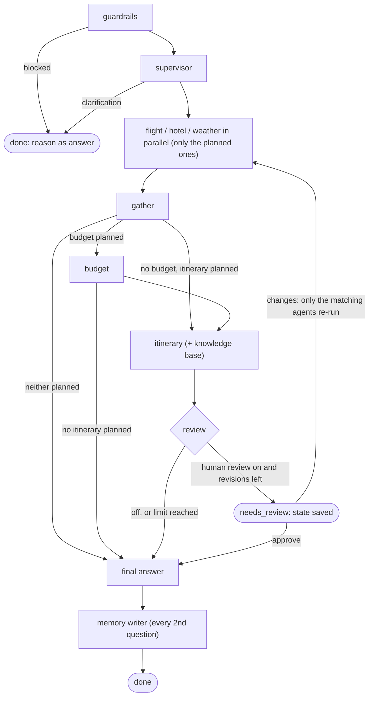
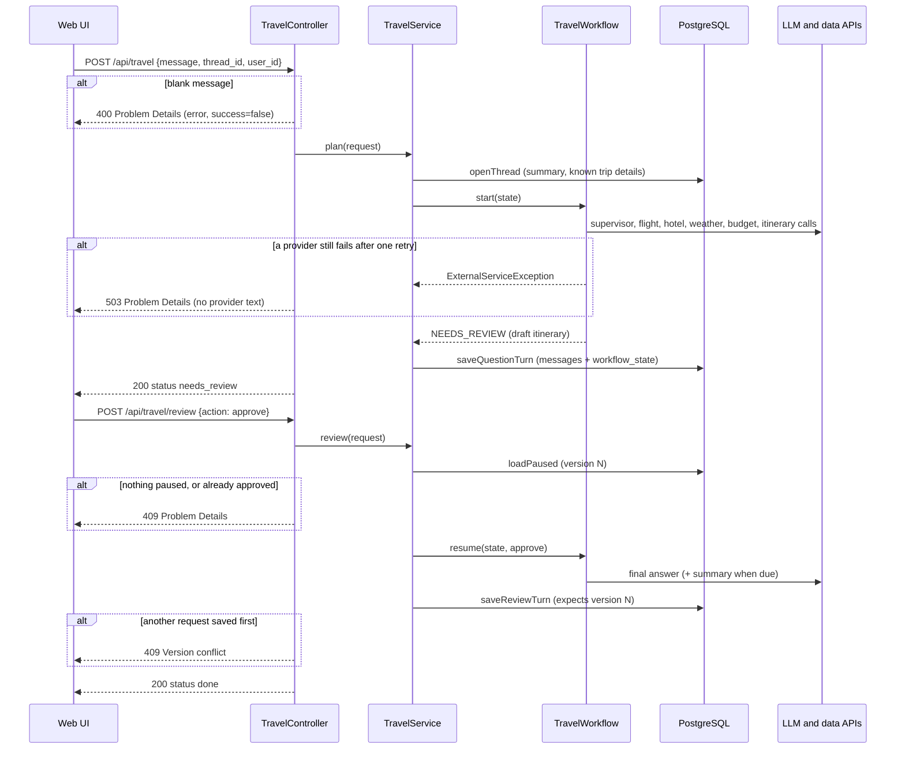
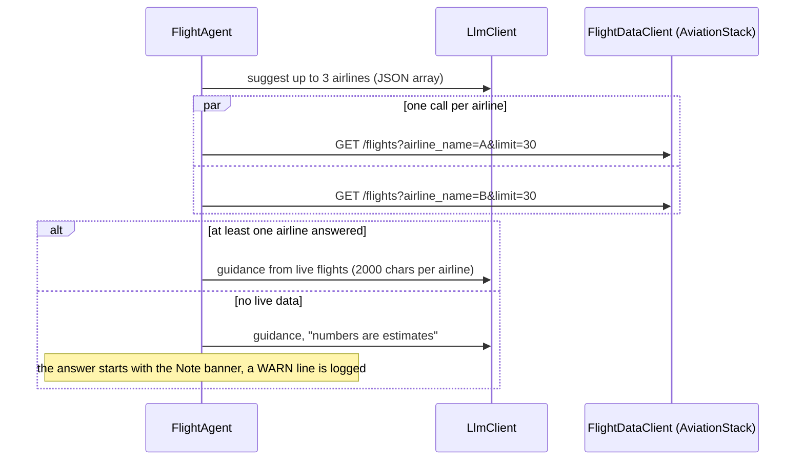
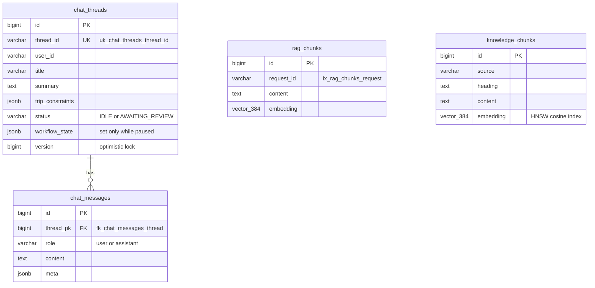
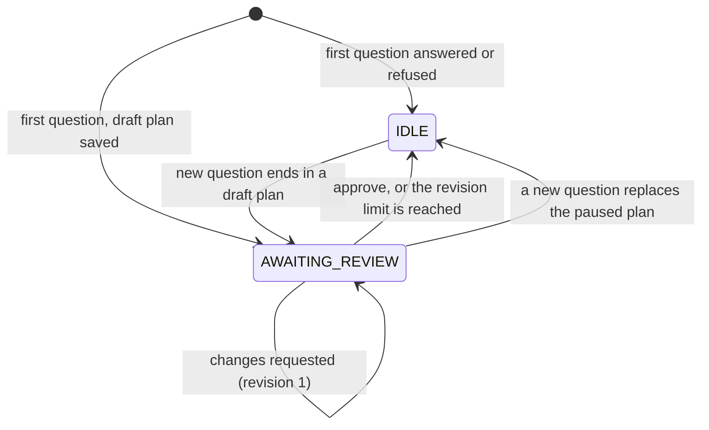

# Architecture

What is this? MyTripAdvision Agent is a travel planner. You describe a trip in plain words; a team of small "agents" (flights, hotels, weather, budget, itinerary) works on it and you get a written plan. Before the final answer you can approve the draft or ask for changes. This service is the Java port of the original Python app and keeps the same web page and the same API.

Names in the diagrams are the names in the code (`src/main/java/com/mytripadvision/...`).

## 1. System context

- The browser only talks to this service. Every call to a provider is made from Java over HTTP (no Python, no MCP).
- The database holds chats, paused plans and the two vector tables.
- The embedding model (`BAAI/bge-small-en-v1.5`) runs inside the service; it is downloaded once into `mytripadvision.rag.embedding.cache-dir`.

## 2. Components

- `TravelService` is deliberately not transactional: the workflow makes slow remote calls, and no database transaction stays open during them. Each save in `HistoryService` is its own short transaction.
- Observability is request-id log lines plus `token_usage` in the response. `CorrelationIdFilter` puts a short request id in the log context; the workflow copies the context into the threads of the parallel agents. A small `Usage` object counts the tokens of one request.

## 3. Workflow of one question

What happens, step by step:

1. Guardrails refuse empty, too long (over 1000 characters) or prompt-injection input without any LLM call.
2. The supervisor makes one LLM call: which agents are needed, the trip details, or one clarifying question.
3. Flight, hotel and weather run in parallel on virtual threads; budget and itinerary follow.
4. The draft itinerary is returned with `status: needs_review` and the whole workflow state is stored in `chat_threads.workflow_state`.
5. `POST /api/travel/review` loads that state (any replica, also after a restart) and continues. After two change requests the plan goes out as it is.

## 4. End-to-end sequence

## 5. Flight agent

## 6. Data model

Deleting a thread deletes its messages (cascade).

## 7. Thread lifecycle

